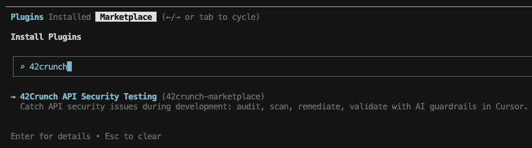
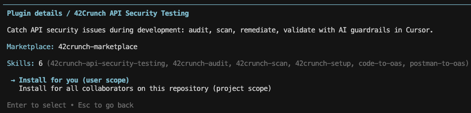
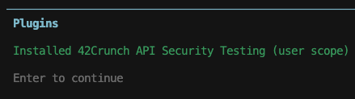

# 42Crunch API Security Plugin

Automate API security directly in Cursor with 42Crunch - audit OpenAPI specs, detect vulnerabilities aligned with OWASP API Security risks (including BOLA/BFLA), and apply AI-powered fixes.

## Overview

The `42crunch-api-security-testing` plugin is designed for AI-assisted development workflows, it provides continuous guardrails through an **audit->scan->remediate->validate** loop, ensuring APIs meet enterprise security standards before deployment.

## Commands

| Skill | Description |
|---|---|
| [`/42crunch-setup`](./README.md#42crunch-setup) | Install the `42c-ast` binary and configure credentials (one-time) |
| [`/42crunch-audit`](./README.md#42crunch-audit) | Static security audit of an OpenAPI Specification file with scored findings and AI-assisted fixes |
| [`/42crunch-scan`](./README.md#42crunch-scan) | Live conformance and authorization scan (BOLA/BFLA) against a running API |
| [`/42crunch-api-security-testing`](./README.md#42crunch-api-security-testing) | Full audit + scan pipeline in a single session |
| [`/generate-oas`](./README.md#generate-oas) | Generate a complete `openapi.json` from your API source code, a Postman/Insomnia collection, or both |

## Prerequisites

- [Cursor](https://cursor.com)
- A 42Crunch account — [Free Trial](https://42crunch.com/freemium/?source=cursor) or paid (Platform API key)
- For `42crunch-scan`: a running API server reachable at the URL in `servers[0]` of your OAS (or via `SCAN42C_HOST`)

The `42c-ast` binary is downloaded and kept up to date automatically on first use.

## Installation

> **Requirement:** The [Cursor CLI](https://cursor.com/cli) is required to add marketplaces and install plugins using the commands below.

Add the 42Crunch marketplace:

1. In terminal/command prompt, type `agent` and press **Enter** to run the Cursor CLI agent.

2. Add the 42Crunch Marketplace:
```
/plugin marketplace add https://github.com/42Crunch-AI/cursor-plugins
```

Install the `42crunch-api-security-testing` plugin:

1. In terminal/command prompt, type `agent` and press **Enter** to run the Cursor CLI agent.

2. Type `/plugin` to open the plugin manager.

3. Navigate to **Marketplace** using the right-arrow key and search for the 42Crunch plugin:
  - Type '42crunch' in the search bar
  - Press **Enter** to select the 42Crunch API Security Testing plugin



5. Select the scope of installation:



6. Press **Enter** to install:



## Quick Start

1. **Install the plugin** — add this marketplace to Cursor.
2. **Set up the environment** — say: *"set up 42crunch"*
3. **Audit your API** — say: *"run a 42Crunch audit"* (Cursor will offer to generate an OAS from source code if you don't have one)
4. **Fix issues** — Cursor presents findings by severity and asks your consent before changing anything
5. **Scan your API** — say: *"run a conformance scan"* against your running server

## Common Scenarios

See [RECIPES.md](./RECIPES.md) for step-by-step guides covering the most common workflows, including:

- Running a **fix-only audit** from an existing report (skip re-running the audit)
- **Review-only mode** — see findings without applying any fixes
- **Full pipeline** (audit + scan) in a single session
- **Scan only** when the audit is already passing
- **Generating an OAS** from source code and/or a Postman/Insomnia collection, then auditing it immediately

## Skills

### `42crunch-setup`

Installs the `42c-ast` binary for your OS/architecture, verifies its checksum, and walks you through credential configuration. Supports Platform (API key) and Free Trial (token) modes. Credentials are stored in `~/.42crunch/conf/env` with `600` permissions.

> **Trigger:** "set up 42crunch", "configure 42crunch", "install 42c-ast", "update 42c-ast", "set api key", "42crunch not working", "binary not found"

**Usage:**
```
/42crunch-setup
```

---

### `42crunch-audit`

Runs a static analysis of an OpenAPI Specification and produces a 0–100 security score. Findings are classified into four tiers:

- **SQG-Blocking** — must fix to pass the Security Quality Gate
- **Security** — recommended fixes
- **Data Validation** — informational
- **Spec Conformance** — OAS format defects outside the score/SQG

Cursor asks your explicit consent before applying any changes, then re-runs the audit to confirm passage.

**Platform mode:** SQG threshold enforced from your platform policy.  
**Free Trial mode:** No automated SQG gate; you set the target score and blocking severity for the session.

> **Trigger:** "run audit", "42crunch audit", "fix audit issues", "SQG audit", "audit score"

**Usage:**
```
/42crunch-audit
```

Cursor will prompt for:
1. OpenAPI Specification file

---

### `42crunch-scan`

Runs a live conformance and authorization test against a running API server. Cursor confirms the target URL, checks reachability, analyses the OAS (operations, auth schemes, BOLA candidates), and presents a scan preview before any configuration begins. After a happy-path validation run, Cursor asks your consent before starting the full fuzzing scan.

Findings are classified into three tiers:

- **Authorization failures** — BOLA/BFLA confirmed
- **SQG-Blocking conformance** — must fix to pass the Security Quality Gate
- **Informational conformance** — surfaced for review

Cursor asks your consent before applying any fixes — both OAS contract updates and server-side code changes.

**Platform mode:** SQG enforced from platform policy.  
**Free Trial mode:** All findings presented informally; you decide what to fix.

> **Trigger:** "run scan", "scan only", "conformance test", "BOLA test", "BFLA test", "42crunch scan", "scan config"

**Usage:**
```
/42crunch-scan
```

Cursor will prompt for:
1. OpenAPI Specification file
2. API host endpoint

---

### `42crunch-api-security-testing`

Orchestrates Audit (Phase 1) and Scan (Phase 2) in sequence. Resolves the OAS file and confirms the scan target URL up front. Each phase requires separate user consent. Produces a combined summary covering both phases.

> **Trigger:** "run audit and scan", "full 42crunch pipeline", "full security check", "audit then scan", "SQG"

**Usage:**
```
/42crunch-api-security-testing
```

Cursor will prompt for:
1. OpenAPI Specification file
2. API host endpoint

---

### `generate-oas`

Generates a complete `openapi.json` from an API codebase, a Postman or Insomnia collection, or both. Cursor asks which sources are available and uses whichever you provide:

- **Codebase only** — detects routes, parameters, request/response schemas, auth middleware, data models, and server config from the source.
- **Postman collection only** — extracts paths, methods, parameters, request/response bodies, headers, and auth schemes from a v2.0/v2.1 collection (and optional environment file), resolving `{{variableName}}` placeholders.
- **Insomnia collection only** — extracts the same contract details from a v4 (JSON) or v5 (JSON or YAML) export, resolving `{{ variableName }}`/`{{ _.variableName }}` templating. Insomnia exports carry no saved example responses, so response shapes are best-effort placeholders unless a codebase is also provided.
- **Codebase + collection** — the codebase is treated as the structural source of truth; the collection enriches the result with real example values and surfaces any endpoint the codebase analysis missed.

Deduplicates schemas into `components/schemas` and performs a self-review pass before writing the file.

Supported frameworks: Express, Fastify, Koa, Hapi, NestJS, FastAPI, Flask, Django, Starlette, Spring Boot, Quarkus, Micronaut, Gin, Echo, Chi, Gorilla/mux, Rails, Sinatra, Grape, ASP.NET Core, and more.

> **Trigger:** "generate OAS", "create OpenAPI spec", "document my API", "reverse-engineer spec", "write openapi.json from my codebase", "convert postman to openapi", "convert insomnia to openapi", "postman collection to OAS", "insomnia collection to OAS", "generate spec from postman", "generate spec from insomnia"

**Usage:**
```
/generate-oas
```

Cursor will prompt for:
1. Whether you have an API codebase, and if so, its location
2. Whether you have a Postman or Insomnia collection, and if so, its file path (and an optional environment file path)
3. Output file path (default: `openapi.json` at the codebase root, or next to the collection file)

---

## Configuration

Credentials are read from `~/.42crunch/conf/env` (macOS/Linux) or `%APPDATA%\42Crunch\conf\env` (Windows), written by `42crunch-setup`. Never edit this file manually while a skill is running.

| Variable | Description | Mode |
|---|---|---|
| `API_KEY` | Platform token (`api_*` or `ide_*`) | Platform |
| `PLATFORM_HOST` | 42Crunch platform base URL (e.g. `https://us.42crunch.cloud`) | Platform |
| `TRIAL_TOKEN` | Free Trial token (Base64) | Free Trial |
| `SCAN42C_HOST` | Override scan target URL (overrides `servers[0]` in OAS) | Both |

Credentials are never printed in plaintext after entry.

---

## Links

- [42Crunch](https://42crunch.com/)
- [42Crunch Documentation](https://docs.42crunch.com)
- [42Crunch on GitHub](https://github.com/42Crunch)
- Support: support@42crunch.com

## License

Apache 2.0 — see [LICENSE](./LICENSE) for details.
